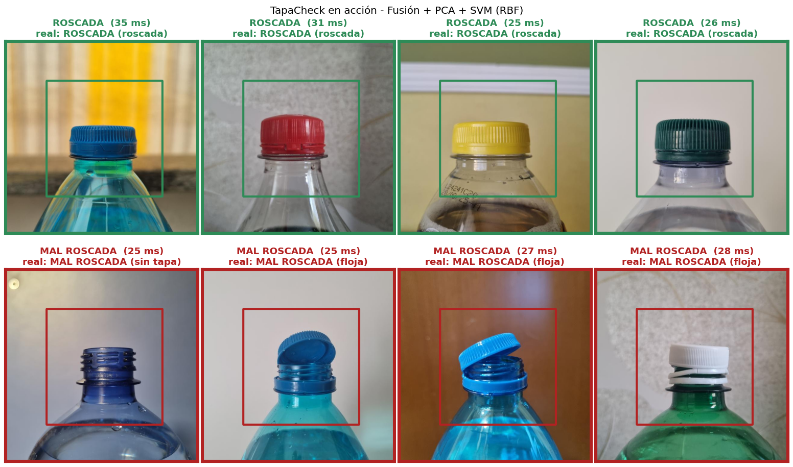

# TapaCheck — Inspección automática del roscado de tapas

**Start-up de Visión Artificial B2B** · Entrega 3 · Visión Artificial · ITM 2026
**Integrante:** Sebastian Lopez ([@flechas122](https://github.com/flechas122))

TapaCheck es una cámara para líneas de embotellado que revisa si cada tapa quedó bien roscada. A partir de una foto lateral del cuello de la botella, clasifica la tapa como **ROSCADA** o **MAL ROSCADA** (floja, ladeada o ausente). Usa solo **visión artificial clásica**, sin Deep Learning y sin GPU.



## El problema

Después de llenar la botella, la roscadora pone la tapa y la aprieta. A veces la tapa queda floja, se monta torcida sobre la rosca o la botella sale sin tapa. Esa botella se derrama, pierde el gas o se contamina, y el problema aparece en el cliente. Hoy un operario mira la línea pasar, pero a 2.400 botellas por hora tiene 1,5 segundos para cada una. En inspección visual, la industria detecta en promedio cerca del **80 %** de los defectos (See, 2015, *Human Factors* 57(8)).

## La solución (pipeline clásico)

```
Foto lateral → recorte fijo del cuello (gris, 128×128) → HOG + LBP + GLCM → fusión → Z-score → PCA (95 %) → SVM (RBF) → ROSCADA / MAL ROSCADA
```

1. **Recorte fijo (ROI):** la cámara está fija, así que la tapa siempre cae en el mismo cuadro. El cuadro se calibra una sola vez con las cajas anotadas de `train` (centro mediano y 1,6 veces el ancho mediano de la tapa). Para clasificar, el sistema recibe solo la foto.
2. **Extracción de características:** HOG (forma y bordes, 8.100 valores), LBP uniforme (micro-textura, 10) y GLCM (textura estadística, 48), además de su fusión.
3. **Normalización Z-score** con `StandardScaler`, ajustado solo con `train`, y **reducción PCA** de 8.158 a 1.055 dimensiones.
4. **Clasificación:** k-NN, SVM y Random Forest, comparados en 15 combinaciones. SVM y Random Forest usan `class_weight='balanced'`, porque hay 2,4 tapas roscadas por cada mal roscada.

## Resultados (855 botellas de prueba nunca vistas)

| F1-Score         | k-NN  | SVM (RBF) | Random Forest |
|------------------|:-----:|:---------:|:-------------:|
| HOG              | 0,907 | 0,940     | 0,829         |
| LBP              | 0,702 | 0,694     | 0,713         |
| GLCM             | 0,790 | 0,865     | 0,831         |
| Fusión           | 0,911 | 0,940     | 0,818         |
| **Fusión + PCA** | 0,913 | **0,942** | 0,300         |

**Sistema elegido: Fusión + PCA + SVM.**

| Métrica de negocio | Valor |
|---|---|
| Exactitud global | 96,73 % |
| Tapas mal roscadas detectadas (recall) | 91,16 % (227 de 249) |
| Botellas bien tapadas rechazadas | 0,99 % (6 de 606) |
| Tiempo por botella (CPU, sin GPU) | ~12 ms de cálculo · ~25 ms foto por foto en la demo |
| Costo mensual de errores* | de ~$16,9 M a ~$10,2 M COP (−40 %) |

\* Línea de ejemplo: 2.400 botellas por hora, dos turnos de 8 horas, 26 días al mes, 0,5 % de tapas mal roscadas, $12.000 por botella mal tapada que llega al cliente y $500 por cada botella buena apartada por error. Todos los supuestos se pueden editar en el notebook.

Por tipo de tapa, el sistema acierta el 99,0 % de las roscadas, el 96,8 % de las flojas, el 98,8 % de las botellas sin tapa y el 75,7 % de las ladeadas, que son el caso más difícil.


### ¿Por qué HOG y no GLCM?

- **HOG** sabe *dónde* están los bordes. Una tapa floja o ladeada queda más alta o inclinada y deja ver la rosca en un lugar concreto, entre la tapa y el anillo del cuello. Con SVM, HOG logra una F1 de 0,940 y deja escapar 21 de 249 tapas malas.
- **GLCM** resume la textura de todo el recorte en 48 números y pierde la ubicación. Con el mismo SVM deja escapar 38 tapas malas y aparta 28 botellas buenas (HOG aparta 8).
- **LBP**, con un histograma global de micro-textura, se queda en una F1 de 0,69 a 0,71.

### Prueba con días que el modelo nunca vio

Las 2.849 fotos que usa el sistema se tomaron en cinco días distintos, y casi todas las tapas roscadas son de los dos primeros. Para medir si el modelo aprende el día (luz, fondo, botellas) en lugar del estado de la tapa, el notebook entrena otra vez el sistema elegido con unos días y lo prueba con otros días completos. Ahí el recall baja a 77,4 % y los falsos rechazos suben a 6,3 % (F1 0,815). Es la principal limitación: antes de vender hay que re-entrenar y medir con fotos de la línea del cliente, donde la cámara, la luz y el fondo son fijos.

## Cómo ejecutarlo

1. Clone el repositorio y cree el entorno (Python 3.10):

   ```bash
   python -m venv .venv
   .venv\Scripts\activate
   pip install -r requirements.txt
   ```

2. Consiga el dataset [bottle_cap_sdp](https://universe.roboflow.com/bottlecapproject-dyaxy/bottle_cap_sdp) de Roboflow Universe. Con una cuenta gratuita, haga *Fork* del proyecto y genere una versión con *Auto-Orient* y *Resize* a 640×640 (*Stretch*), **sin aumentación**. Expórtela en formato **YOLOv8** (unos 90 MB) y descomprímala en `data/`. Debe quedar un `data.yaml` dentro de `data/`, junto a las carpetas `train`, `valid` y `test`.
3. Abra el notebook y ejecute todas las celdas en orden. Tarda unos 3 minutos en CPU:

   ```bash
   jupyter notebook TapaCheck_inspeccion_tapas.ipynb
   ```

## Demo en vivo

Al ejecutar el notebook se guarda el modelo entrenado en `modelos/tapacheck.joblib`. Con ese archivo se puede inspeccionar botella por botella:

```bash
python demo_tapacheck.py
```

La demo muestra fotos de `valid` y `test` con el veredicto **ROSCADA / MAL ROSCADA**, el recorte fijo, el tiempo de cada botella y el conteo de aciertos. Use **ESPACIO** para pasar a la siguiente botella y **ESC** para salir. También acepta una foto (`python demo_tapacheck.py foto.jpg`) o una carpeta; las fotos propias deben estar encuadradas como las del dataset, con la tapa en el centro y vista de lado. En Windows basta con doble clic en `ABRIR_DEMO.bat`, o con arrastrar una foto encima.

## Estructura

```
TapaCheck_inspeccion_tapas.ipynb   notebook principal (ejecutado, con resultados)
demo_tapacheck.py, ABRIR_DEMO.bat  demo de inspección en vivo con el modelo guardado
figuras/                           gráficas generadas por el notebook
requirements.txt                   dependencias
data/        (no se sube)          dataset de Roboflow
modelos/     (no se sube)          pipeline entrenado (joblib, ~77 MB)
```

## Dataset y licencia

Fotos del proyecto *bottle_cap_sdp* de **bottlecapproject**, publicado en Roboflow Universe bajo licencia **CC BY 4.0**. Las imágenes no se incluyen en este repositorio por su tamaño; se descargan desde Roboflow como se indica arriba. Este proyecto es académico.
