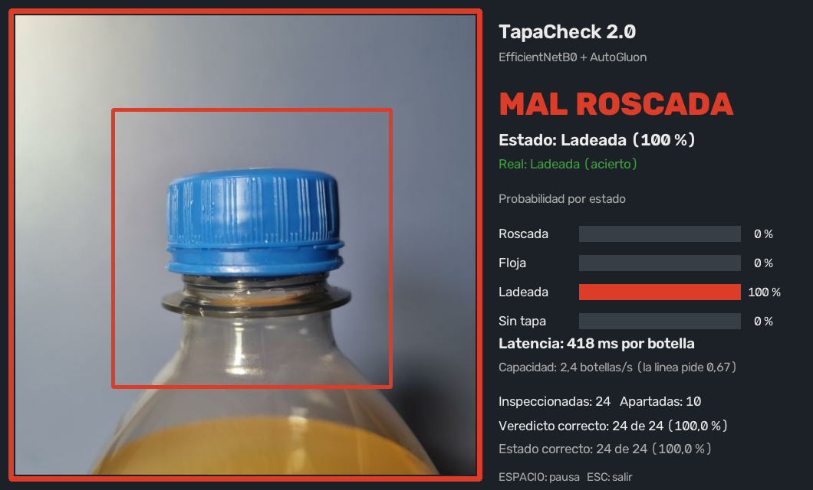
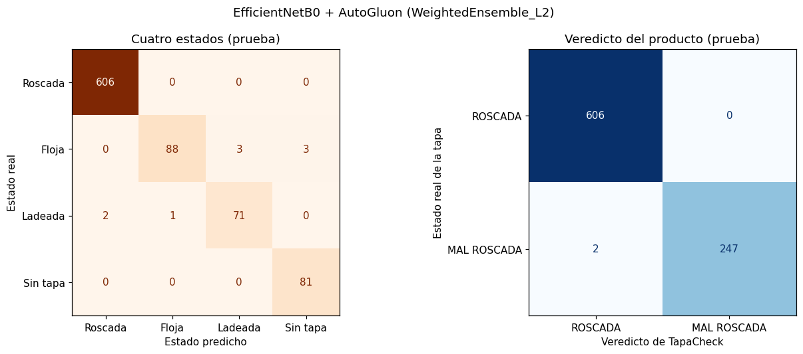
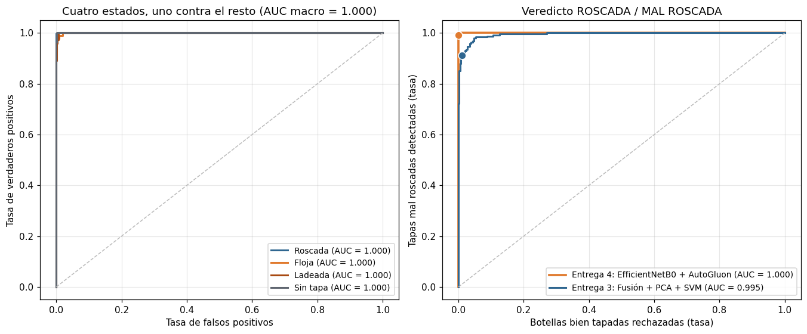
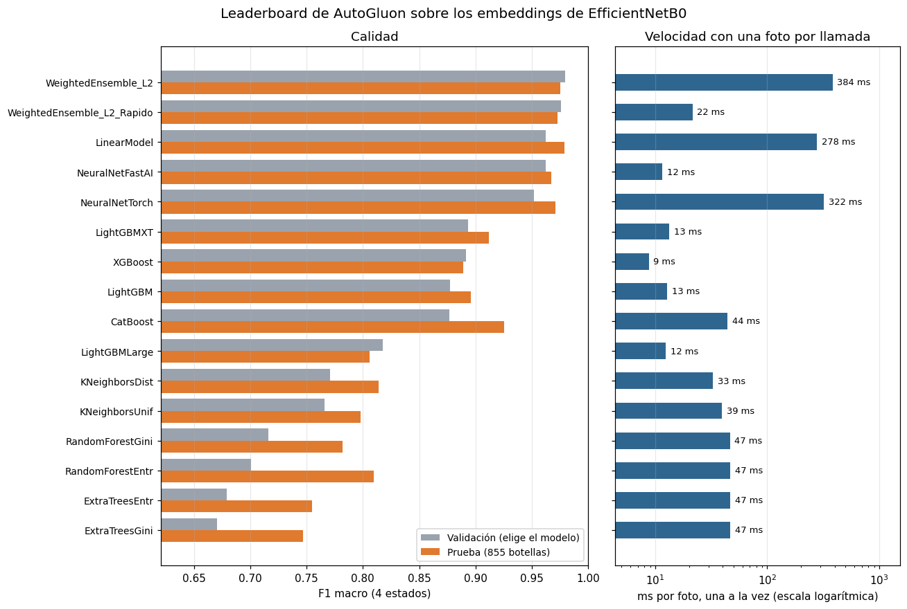
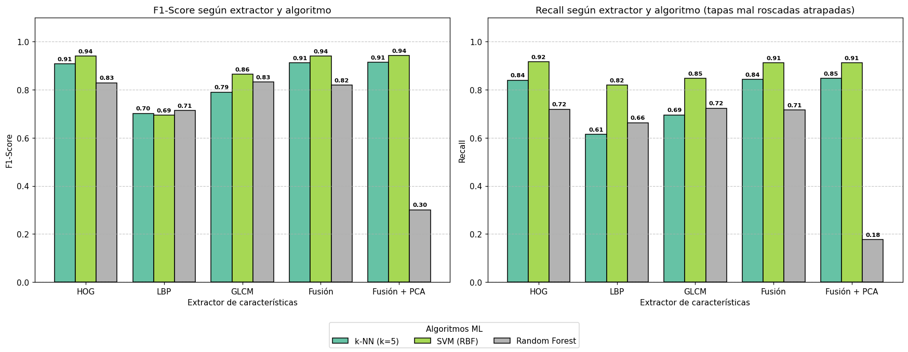

# TapaCheck — Inspección automática del roscado de tapas

**Start-up de Visión Artificial B2B** · Entregas 3 y 4 · Visión Artificial · ITM 2026
**Integrante:** Sebastian Lopez ([@flechas122](https://github.com/flechas122))

TapaCheck es una cámara para líneas de embotellado que revisa si cada tapa quedó bien roscada. A partir de una foto lateral del cuello de la botella, clasifica la tapa como **ROSCADA** o **MAL ROSCADA** (floja, ladeada o ausente). El repositorio tiene dos versiones del sistema, medidas con las mismas 855 botellas de prueba:

| Versión | Entrega | Técnica | Notebook |
|---|---|---|---|
| TapaCheck 1.0 | 3 | Visión clásica: HOG + LBP + GLCM, PCA y SVM | [`TapaCheck_inspeccion_tapas.ipynb`](TapaCheck_inspeccion_tapas.ipynb) |
| **TapaCheck 2.0** | **4** | **Transfer Learning: EfficientNetB0 congelada + AutoGluon** | [`TapaCheck_E4_transfer_learning.ipynb`](TapaCheck_E4_transfer_learning.ipynb) |



## El problema

Después de llenar la botella, la roscadora pone la tapa y la aprieta. A veces la tapa queda floja, se monta torcida sobre la rosca o la botella sale sin tapa. Esa botella se derrama, pierde el gas o se contamina, y el problema aparece en el cliente. Hoy un operario mira la línea pasar, pero a 2.400 botellas por hora tiene 1,5 segundos para cada una. En inspección visual, la industria detecta en promedio cerca del **80 %** de los defectos (See, 2015, *Human Factors* 57(8)).

## TapaCheck 2.0 (Entrega 4): Transfer Learning + AutoGluon

```
Foto lateral → recorte fijo del cuello (color, 224×224) → EfficientNetB0 congelada (ImageNet) → embedding de 1.280 valores
             → AutoGluon (ensamble de modelos tabulares) → estado de la tapa → ROSCADA / MAL ROSCADA
```

1. **Selección de la red base.** Se compararon EfficientNetB0, MobileNetV2, ResNet50 y DenseNet121 con una sonda lineal (Z-score + regresión logística) en validación cruzada de 5 particiones sobre `train`, midiendo también el tiempo por foto en CPU. El conjunto de prueba no participa en la elección.
2. **`tf.data`.** `from_tensor_slices` → `map` (leer en RGB, recorte fijo, redimensión a 224×224) → `map` (normalización de la red) → `batch(32)` → `prefetch`. Los `map` son deterministas, así que el orden de salida es el de las rutas.
3. **Extractor de embeddings.** La red se carga con `include_top=False`, `pooling='avg'` y `trainable = False`: cada foto se convierte en un vector de 1.280 valores. Con ellos se arma un `DataFrame` con las columnas `f_0 … f_1279` y la etiqueta `estado`; las etiquetas viajan en el mismo `tf.data` que las imágenes y el notebook comprueba la alineación fila por fila.
4. **Cabeza de decisión.** `TabularPredictor(label='estado', problem_type='multiclass', eval_metric='f1_macro', sample_weight='balance_weight')` con `time_limit=600` y `presets='medium_quality'`. Entrena los modelos por defecto de AutoGluon (LightGBM, CatBoost, XGBoost, Random Forest, Extra Trees y dos redes neuronales) más regresión logística y k-NN, y arma un ensamble ponderado. El veredicto es MAL ROSCADA si el estado predicho no es `Roscada`.

| Red (ImageNet, congelada) | Parámetros | ms por foto (CPU) | F1 macro (CV en train) | Recall MAL ROSCADA (CV) |
|---|:-:|:-:|:-:|:-:|
| **EfficientNetB0** | 4,0 M | 27,5 | 0,976 | **0,991** |
| MobileNetV2 | 2,3 M | 19,9 | 0,956 | 0,979 |
| ResNet50 | 23,6 M | 57,8 | 0,968 | 0,981 |
| DenseNet121 | 7,0 M | 73,2 | **0,979** | 0,988 |

**Red elegida: EfficientNetB0.** La regla, fijada antes de medir, era quedarse con la de mejor F1 macro, salvo que otra a menos de 0,01 fuera más rápida. DenseNet121 quedó primera por solo 0,003 y es 2,7 veces más lenta. EfficientNetB0 además es la que más tapas mal roscadas detecta en la validación cruzada, pesa 16 MB y está diseñada para dar la mayor precisión por operación (escala a la vez profundidad, ancho y resolución), algo clave para correr en el CPU de la planta.

### Resultados (855 botellas de prueba nunca vistas)

| Métrica | Entrega 3: Fusión + PCA + SVM | Entrega 4: EfficientNetB0 + AutoGluon |
|---|:-:|:-:|
| Exactitud | 96,7 % | **99,8 %** |
| Tapas mal roscadas detectadas (recall) | 91,2 % (227 de 249) | **99,2 % (247 de 249)** |
| Botellas bien tapadas rechazadas | 1,0 % (6 de 606) | **0,0 % (0 de 606)** |
| F1-Score (MAL ROSCADA) | 0,942 | **0,996** |
| AUC ROC | 0,995 | **1,000** |
| Tiempo por botella, de punta a punta (CPU) | **24 ms** | 404 ms |
| Tamaño de los modelos | 77 MB | **34 MB** |
| Botellas mal tapadas que llegan al cliente (mes)* | 441 | **40** |
| Costo mensual de errores* | $10,2 M | **$0,48 M** |

\* Línea de ejemplo: 2.400 botellas por hora, dos turnos de 8 horas, 26 días al mes, 0,5 % de tapas mal roscadas, $12.000 por botella mal tapada que llega al cliente y $500 por cada botella buena apartada por error. Con inspección manual (80 % de detección y 1 % de falsos rechazos) el costo sería de ~$16,9 M al mes.

Por tipo de tapa, el veredicto acierta el 100 % de las roscadas, de las flojas y de las botellas sin tapa, y el 97,3 % de las ladeadas (en la Entrega 3: 99,0 %, 96,8 %, 98,8 % y 75,7 %). Las dos tapas que se escapan son ladeadas. En los cuatro estados, el reporte de clasificación da un F1 macro de 0,975: lo que más se confunde es una tapa floja con una ladeada o con una botella sin tapa, que de todos modos se aparta.





### Leaderboard de AutoGluon

AutoGluon entrenó 15 modelos sobre los embeddings y un ensamble ponderado. Además, con `fit_weighted_ensemble`, se armó un segundo ensamble solo con los modelos que responden una foto en 20 ms o menos.

| Modelo | F1 macro (validación) | F1 macro (prueba) | ms por foto (una a la vez) |
|---|:-:|:-:|:-:|
| **WeightedEnsemble_L2** (regresión logística + fastai + k-NN) | **0,980** | 0,975 | 384 |
| WeightedEnsemble_L2_Rapido (fastai + XGBoost) | 0,976 | 0,973 | 22 |
| LinearModel (regresión logística) | 0,962 | 0,979 | 278 |
| NeuralNetFastAI | 0,962 | 0,967 | 12 |
| NeuralNetTorch | 0,952 | 0,971 | 322 |
| LightGBM, XGBoost, CatBoost (5 variantes) | 0,82 – 0,89 | 0,81 – 0,93 | 9 – 44 |
| k-NN (2 variantes) | 0,77 | 0,80 – 0,81 | 33 – 39 |
| Random Forest y Extra Trees (4 variantes) | 0,67 – 0,72 | 0,75 – 0,81 | ~47 |

- **Ganan los modelos que usan todo el vector a la vez.** El embedding de EfficientNetB0 deja los estados casi separados por planos, y eso es justo lo que aprovechan la regresión logística y las redes pequeñas.
- **Los árboles quedan atrás.** Un árbol decide mirando una columna a la vez, y en un embedding la información está repartida en cientos de columnas que aportan poco cada una. Es lo mismo que le pasó al Random Forest con PCA en la Entrega 3.
- **El ensamble gana porque combina modelos que fallan en fotos distintas**, y queda primero en validación. La regresión logística sola saca el mejor F1 en prueba, pero el modelo se elige por validación.
- **En lote todos son rápidos; una foto a la vez, no.** Con una foto por llamada, la regresión logística y la red de PyTorch tardan ~300 ms, porque su preprocesamiento transforma por separado cada columna sesgada del embedding. **Va a la línea** el de mejor F1 en validación entre los que responden en menos de medio ciclo de la línea (750 ms): `WeightedEnsemble_L2`.



### Prueba con días que el modelo nunca vio

Se repite el experimento más difícil de la Entrega 3: entrenar con unos días de captura (tapas roscadas del 29 de octubre y mal roscadas del 31 de octubre y del 4 de noviembre) y probar con días completos que el modelo nunca vio (30 de octubre y 1 de noviembre).

| Días nunca vistos (693 botellas) | Entrega 3 | Entrega 4 |
|---|:-:|:-:|
| Tapas mal roscadas detectadas | 77,4 % (178 de 230) | **88,7 % (204 de 230)** |
| Botellas bien tapadas rechazadas | 6,3 % (29 de 463) | **3,9 % (18 de 463)** |
| Exactitud | 88,3 % | **93,7 %** |
| F1-Score | 0,815 | **0,903** |

La red preentrenada generaliza mejor a días nuevos, pero sigue siendo la principal limitación: con otra luz, otro fondo u otras botellas, el sistema pierde precisión. Antes de instalarlo en una planta hay que sumar fotos de la línea del cliente.

## Comprobación en tiempo real

Al ejecutar el notebook de la Entrega 4 se guardan la configuración (`modelos/tapacheck_e4.json`) y una copia mínima de AutoGluon para desplegar (`modelos/autogluon_e4_despliegue/`). Con eso, `demo_tiempo_real.py` inspecciona en vivo:

```bash
python demo_tiempo_real.py                # flujo continuo con fotos de valid + test (simula la banda transportadora)
python demo_tiempo_real.py --camara 0     # cámara del computador, en vivo
python demo_tiempo_real.py carpeta/       # las fotos de una carpeta (o una sola foto)
```

La ventana muestra el veredicto, el estado más probable, la probabilidad de cada estado, la latencia por botella, la capacidad (botellas por segundo) y, con fotos del dataset, el conteo de aciertos. **ESPACIO** pausa y **ESC** (o la X) sale. `--intervalo 700` fija los milisegundos de cada foto del flujo (0 = lo más rápido posible) y `--limite 50` detiene la demo tras N fotos. En Windows también se abre con doble clic en `ABRIR_DEMO_TIEMPO_REAL.bat`. Con la cámara, la tapa debe quedar dentro del recuadro, vista de lado y encuadrada como en las fotos del dataset.

En el CPU de un portátil, cada botella tarda unos 0,4 s de punta a punta (leer la foto, recortar, red y AutoGluon): unas 2,5 botellas por segundo, cuando la línea pide 0,67 (una cada 1,5 s). La mayor parte de ese tiempo es la regresión logística del ensamble con una foto a la vez; el ensamble rápido del leaderboard respondería en unos 20 ms. Bajar ese costo sin perder precisión es el objetivo de la Entrega 5.

## TapaCheck 1.0 (Entrega 3): visión clásica

```
Foto lateral → recorte fijo del cuello (gris, 128×128) → HOG + LBP + GLCM → fusión → Z-score → PCA (95 %) → SVM (RBF) → ROSCADA / MAL ROSCADA
```

1. **Recorte fijo (ROI):** la cámara está fija, así que la tapa siempre cae en el mismo cuadro. El cuadro se calibra una sola vez con las cajas anotadas de `train` (centro mediano y 1,6 veces el ancho mediano de la tapa). Para clasificar, el sistema recibe solo la foto. La Entrega 4 usa el mismo cuadro.
2. **Extracción de características:** HOG (forma y bordes, 8.100 valores), LBP uniforme (micro-textura, 10) y GLCM (textura estadística, 48), además de su fusión.
3. **Normalización Z-score** con `StandardScaler`, ajustado solo con `train`, y **reducción PCA** de 8.158 a 1.055 dimensiones.
4. **Clasificación:** k-NN, SVM y Random Forest, comparados en 15 combinaciones. SVM y Random Forest usan `class_weight='balanced'`, porque hay 2,4 tapas roscadas por cada mal roscada.

| F1-Score         | k-NN  | SVM (RBF) | Random Forest |
|------------------|:-----:|:---------:|:-------------:|
| HOG              | 0,907 | 0,940     | 0,829         |
| LBP              | 0,702 | 0,694     | 0,713         |
| GLCM             | 0,790 | 0,865     | 0,831         |
| Fusión           | 0,911 | 0,940     | 0,818         |
| **Fusión + PCA** | 0,913 | **0,942** | 0,300         |

**Sistema elegido: Fusión + PCA + SVM**, con 96,7 % de exactitud, 227 de 249 tapas mal roscadas detectadas y 6 de 606 botellas buenas rechazadas. Su punto débil eran las tapas ladeadas (75,7 % de acierto) y los días de captura nuevos (77,4 % de detección), justo lo que mejora la Entrega 4.



- **HOG** sabe *dónde* están los bordes. Una tapa floja o ladeada queda más alta o inclinada y deja ver la rosca en un lugar concreto, entre la tapa y el anillo del cuello. Con SVM, HOG logra una F1 de 0,940.
- **GLCM** resume la textura de todo el recorte en 48 números y pierde la ubicación. Con el mismo SVM deja escapar 38 tapas malas y aparta 28 botellas buenas (HOG aparta 8).
- **LBP**, con un histograma global de micro-textura, se queda en una F1 de 0,69 a 0,71.

La demo de esta versión se abre con `python demo_tapacheck.py` (o `ABRIR_DEMO.bat`) y usa `modelos/tapacheck.joblib`: muestra fotos de `valid` y `test` con el veredicto, el recorte fijo y el tiempo de cada botella. **ESPACIO** pasa a la siguiente y **ESC** sale.

## Cómo ejecutarlo

1. Clone el repositorio y cree el entorno (Python 3.10). La Entrega 4 instala TensorFlow y AutoGluon, unos 3 GB:

   ```bash
   python -m venv .venv
   .venv\Scripts\activate
   pip install -r requirements.txt
   ```

2. Consiga el dataset [bottle_cap_sdp](https://universe.roboflow.com/bottlecapproject-dyaxy/bottle_cap_sdp) de Roboflow Universe. Con una cuenta gratuita, haga *Fork* del proyecto y genere una versión con *Auto-Orient* y *Resize* a 640×640 (*Stretch*), **sin aumentación**. Expórtela en formato **YOLOv8** (unos 90 MB) y descomprímala en `data/`. Debe quedar un `data.yaml` dentro de `data/`, junto a las carpetas `train`, `valid` y `test`.
3. Ejecute los notebooks en orden, todas las celdas:

   ```bash
   jupyter notebook TapaCheck_inspeccion_tapas.ipynb        # Entrega 3, unos 3 minutos en CPU
   jupyter notebook TapaCheck_E4_transfer_learning.ipynb    # Entrega 4, unos 17 minutos en CPU
   ```

   El de la Entrega 4 descarga la primera vez los pesos de ImageNet de las cuatro redes (~150 MB), guarda los embeddings en `modelos/` para no recalcularlos y entrena AutoGluon durante 10 minutos. Si existe `modelos/tapacheck.joblib` (lo deja el notebook de la Entrega 3), también compara contra ese sistema.

## Estructura

```
TapaCheck_E4_transfer_learning.ipynb       Entrega 4: EfficientNetB0 congelada + AutoGluon (ejecutado, con resultados)
TapaCheck_inspeccion_tapas.ipynb           Entrega 3: HOG + LBP + GLCM, PCA y SVM (ejecutado, con resultados)
demo_tiempo_real.py, ABRIR_DEMO_TIEMPO_REAL.bat   comprobación en tiempo real de la Entrega 4
demo_tapacheck.py, ABRIR_DEMO.bat          demo de la Entrega 3
figuras/                                   gráficas de los notebooks (las de la Entrega 4 empiezan por e4_)
requirements.txt                           dependencias
data/        (no se sube)                  dataset de Roboflow
modelos/     (no se sube)                  modelos entrenados y caché de embeddings
```

## Dataset y licencia

Fotos del proyecto *bottle_cap_sdp* de **bottlecapproject**, publicado en Roboflow Universe bajo licencia **CC BY 4.0**. Las imágenes no se incluyen en este repositorio por su tamaño; se descargan desde Roboflow como se indica arriba. Este proyecto es académico.
